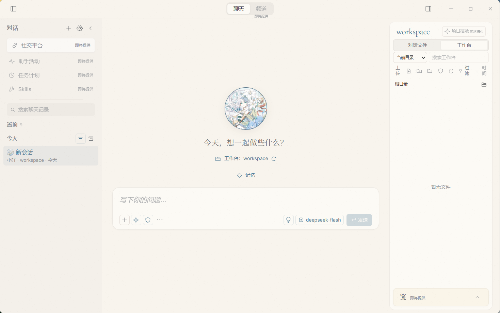

# CAgent

**在你自己的电脑上，运行一个真正属于你的 AI 工作台。**

CAgent 是一款本地优先（Local-First）的桌面智能助手，将对话、文件与文档协作整合进一个安静、可靠的工作台。数据默认保存在你的设备上，无需上传云端，隐私始终掌握在自己手中。



## 为什么选择 CAgent

- **本地优先，隐私为核** —— 数据默认存储在本地，服务仅监听本机回环地址，密钥加密保存。你的对话与文件，只属于你自己。
- **多模型自由接入** —— 适配主流模型协议，供应商与模型灵活配置，支持推理档位切换与用量统计，不被单一平台绑定。
- **对话即工作台** —— 流式回复、思考过程与工具调用全程可见；支持图片、PDF、Word 等多种附件，会话可编辑、分叉、检索与导出。
- **文件与文档协作** —— 安全授权工作目录，在 Markdown 与源码的编辑、预览、搜索之间自由切换；改动自动留存草稿，意外可恢复。
- **沉浸而克制的界面** —— 暖纸 / 青夜双主题，多字体与多语言（简中、繁中、英文、日文、韩文），为长时间使用而设计。
- **安装与更新** —— 提供 Windows 安装包，可选择安装位置；启动后自动检查更新，在应用内下载并重启安装。

## 快速开始

```powershell
# 环境要求：Node.js 24+ 与 pnpm 11
pnpm install --frozen-lockfile
pnpm run setup:desktop
pnpm run build
pnpm start
```

开发时可通过环境变量 `CAGENT_HOME` 指定独立的数据目录，与日常使用互不影响。

## 下载

最新 Windows 安装包可在 [Releases](https://github.com/luojuncheng0327-cell/CAgent/releases) 获取，下载名称以 `-Setup.exe` 结尾的文件并运行。原有便携版用户需要先手动安装一次；聊天记录与配置仍使用原有的用户数据目录。

默认工作目录固定为用户目录下的 `.CAgent/workspace`，新建会话时会自动创建；目录被删除后会重建空目录，不会恢复已删除的文件。旧会话保留原来的目录绑定，会话内仍可授权其他文件夹。会话列表中可直接删除会话，确认后清理聊天记录、附件和编辑草稿，保留磁盘工作文件。

在“设置 → 供应商”可以删除接口，确认后清理该接口的 URL、已保存的 Key、自定义请求头及关联模型，保留聊天历史；关联会话重新选择其他模型后即可继续。仅清除 Key 可使用“编辑接口 → 清除已保存的凭据”。

安装版启动约 10 秒后检查 GitHub 更新，之后每 4 小时检查一次；也可在“设置 → 关于 CAgent”手动检查。发现更新后选择“下载更新”，完成后选择“重启安装”。升级前会保存草稿，仍在运行的会话需要先停止。当前为未签名的预览版本，自动更新使用 GitHub 发布附件及 SHA-512 校验；卸载默认保留用户数据。

## 技术栈

Electron · React · TypeScript · Node.js · Vite，使用 pnpm 管理。

## 文档

更多开发与验证资料位于 [`docs/`](docs) 目录，包括功能实现情况、验证记录与完整规格。

## 状态与许可

项目正在积极开发中，当前为预览版本。`package.json` 标记为 `UNLICENSED`，开源许可将在后续确定。
