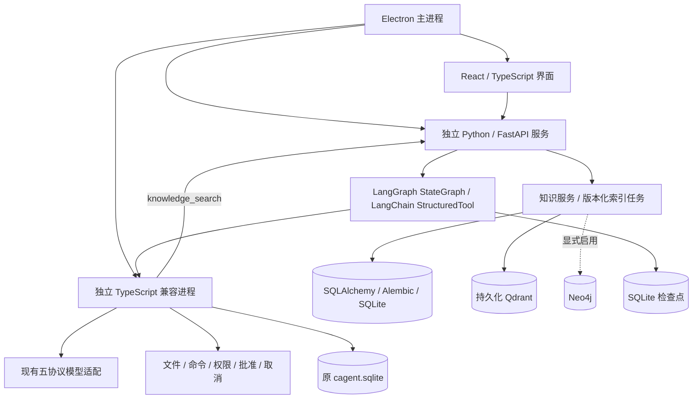

# 技术栈与迁移说明

2026-10-13，迁移分支 `codex/modern-stack`，开发预览 `0.2.0`。本次由用户授权升级项目架构与技术栈；仍交付 Windows 桌面应用。界面按用户提供的截图保留左侧会话、中间聊天与输入框、右侧工作台，迁移只改底层，不擅自增加面板、页面或入口。这里描述当前代码已经接入的职责和后续迁移边界，验证结果统一记录在 `VALIDATION.md`。

## 当前结构



| 层 | 当前技术与职责 | 迁移范围 |
|---|---|---|
| 桌面与界面 | Electron、React、TypeScript、Vite | 保留 Windows 桌面交互与已有界面行为 |
| 界面状态 | TanStack Query、Zustand | 查询缓存接入应用快照；导航状态接入 Zustand，其他状态按模块迁移 |
| 公开 API | FastAPI、Pydantic、Uvicorn | `/api/v1` 网关、输入与来源校验；已有业务 API 经兼容服务转发 |
| Agent 编排 | LangGraph、LangChain | 实际聊天与压缩由图驱动；工具使用 StructuredTool 转到已有受保护的执行入口 |
| 业务兼容层 | 独立 Node / TypeScript 进程 | 现有模型传输、工具权限、批准、取消、队列、聊天数据与凭据管理继续在此运行 |
| 文档与索引 | SQLAlchemy、Alembic、Qdrant | 新后端独立数据库、版本化文档及索引任务；本地向量索引持久化 |
| 可选图谱 | Neo4j 驱动 | 有来源的实体关系写入、删除与邻居查询；需配置 Neo4j 服务 |
| 可选服务部署 | PostgreSQL、Redis、Celery、Docker Compose | 可选基础设施与索引 worker；普通桌面无需启动这些服务 |

## 执行、数据与恢复

Electron 通过私有输入管道传入独立的公开和内部凭据，等待两个后端进程就绪后再打开窗口。服务只监听 `127.0.0.1`，内部请求明确绕过环境代理，普通模型请求可继续使用用户的网络代理。凭据不放入命令行，也不进入图检查点；内部接口不对界面开放。

一次聊天以原运行编号进入 LangGraph，图依次执行模型、工具及下一轮模型节点。检查点只保存运行编号、调用编号、轮数等引用，完整对话、工具参数和凭据留在兼容层。已有写操作批准、只读控制、取消和 `TOOL_OUTCOME_UNKNOWN` 恢复规则继续生效。使用过的运行编号不能作为重放入口；意外中断后需要手动核对副作用。

| 数据 | 默认位置，均相对 `CAGENT_HOME` | 当前归属 |
|---|---|---|
| 聊天、配置、草稿、文件历史与审计 | `cagent.sqlite` | TypeScript 兼容层 |
| 文档、分块、版本和索引任务 | `backend/application.sqlite` | SQLAlchemy / Alembic |
| 向量索引 | `backend/qdrant/` | 本地 Qdrant，仅一个进程持有 |
| 图执行检查点 | `backend/checkpoints.sqlite` | LangGraph |
| 服务临时文件 | `backend/tmp/` | 当前隔离数据目录 |
| 可选关系图谱 | 显式配置的 Neo4j 数据库 | 通过助手、空间和文档版本限定访问 |

没有自动复制或迁移原聊天数据库。现有中立备份不包含新后端知识文档、Qdrant / Neo4j 索引或图检查点；完整备份扩展仍待实现。

## 后端知识服务

本轮保留原有聊天、设置和手工记忆界面，不新增知识库管理面板。知识服务通过 `/api/v1/knowledge/{agent_id}` 提供文档列表、文本写入、删除、检索、健康状态与索引重试接口；需要本应用会话或公开凭据鉴权。每份文档最多 512 KiB，调用方主动提交文本，同一文档编号写入新版本，删除后不会返回过期索引；助手之间的数据隔离。界面管理入口的后续设计另行确定。

默认使用关键词检索，不会自动下载嵌入模型或调用收费接口。要使用语义检索，显式设置 `CAGENT_EMBEDDING_URL`、`CAGENT_EMBEDDING_MODEL` 和 `CAGENT_EMBEDDING_KEY`，三个配置齐全才启用；无需鉴权的本地接口可配置其允许的占位 Key。地址是 OpenAI 兼容嵌入接口的基础 URL。服务也接受调用者提供的分块向量。检索输出保留文档、版本、片段和字符偏移来源。

开启助手记忆后，聊天模型会获得 `knowledge_search` 工具。工具只能检索当前助手的知识空间，不能指定其他助手编号。禁用记忆、禁用该工具或移除助手后会重新校验权限。

Neo4j 是可选关系存储。当前支持调用者提供实体关系及固定的邻居查询；尚未自动从文档抽取图谱，也未完成图谱与向量融合的 GraphRAG 链路。可选服务、环境变量和 Celery worker 的运行方法见 [`deploy/README.md`](../deploy/README.md)。

## 开发与验证

```powershell
pnpm install --frozen-lockfile
pnpm run setup:desktop
pnpm run setup:backend
pnpm run build
pnpm start
```

开发后端使用 Python 3.12。`setup:backend` 默认创建项目内的 `.runtime/backend-venv`，并按 `backend/uv.lock` 安装固定依赖及测试所需的 postgres / worker extras，避免可选 worker 回归被跳过；普通桌面启动不会连接这些可选服务。`CAGENT_PYTHON` 可以显式指定开发解释器。当前 Windows 打包脚本使用 Python 3.12 的可分发运行时与已锁定的依赖，不修改系统 Python。

```powershell
pnpm run verify
pnpm run test:desktop
```

本机 Codex 运行环境中的 Python 对系统临时目录有写入限制，验证时使用工作区内的临时目录：

```powershell
New-Item -ItemType Directory -Force .runtime/test-temp | Out-Null
$env:TEMP = (Resolve-Path .runtime/test-temp).Path
$env:TMP = $env:TEMP
pnpm run verify
pnpm run test:desktop
```

这些变量只影响当前测试终端；正常桌面数据仍由 `CAGENT_HOME` 决定。全部自动化使用隔离数据和本机模型夹具，不能替代真实账号、干净虚拟机安装或完整产品验收。

## 打包与后续迁移

`pnpm run package:win` 构建 NSIS 安装包，内置 Python、后端代码、迁移文件和运行依赖，始终使用 `--publish never`。本轮预览保存在 `release/modern-stack/`，不安装到日常环境；包内验收可将 `CAGENT_MODERN_TEST_EXE` 指向该目录下的 `win-unpacked/CAgent.exe`。

下一阶段逐模块迁移模型适配、配置与会话 API，再迁移工具与业务存储。每个模块保持公开契约及已有恢复、权限与取消行为，并以回归验证后才移除对应兼容入口。自动图谱抽取、知识库完整备份、真实 Neo4j / PostgreSQL / Redis 联调继续单独验收。

冻结的 210 项功能规格没有因为框架升级而完成；功能数量及各项边界见 [`功能实现情况.md`](功能实现情况.md)。
